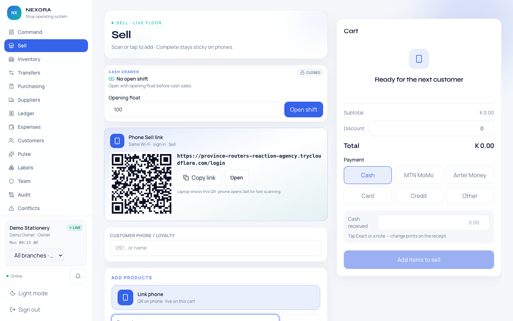
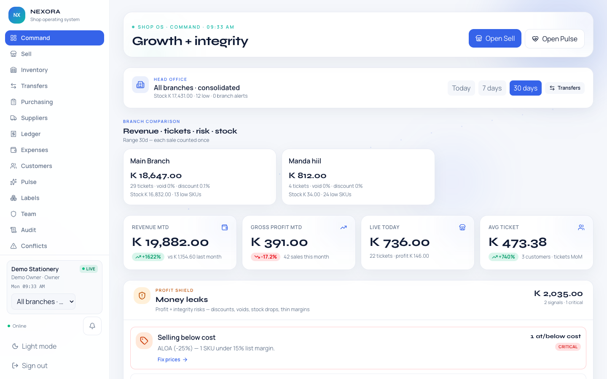

# NEXORA — Full operator documentation (inside the app)

This guide documents **the real screens** in NEXORA — laptop and phone.  
Interactive version with screenshots + voice: **`/guide`** (public) or **`/app/guide`** (signed in).

Screenshots live in `public/docs/guide-screens/` (`*-desktop.png`, `*-phone.png`).

---

## How to use this guide

1. Open `/guide` and toggle **Laptop** / **Phone**.
2. Open each screen chapter.
3. Press **Voice guide** / **Hear this screen** — the app narrates what you are looking at.
4. Practice the steps on the real Sell / Command pages.

---

## Screen map

| Screen | Who | What it is for |
|--------|-----|----------------|
| **Sell** | Cashier | Scan/tap, pay, receipt |
| **Command** | Owner | Health, leaks, Trust, branches |
| **Inventory** | Stock | Catalogue, receive, low stock |
| **Ledger** | Manager | Sales history, void, reprint |
| **Pulse** | Owner | Health advisor, reorders, ask |
| **Customers** | Staff | Loyalty, credit, overdue |
| **Team** | Owner | Roles, invites, keys |
| **Expenses** | Owner | Costs so profit is real |
| **Audit** | Owner | Diary of voids, stock, PIN |
| **Settings** | Owner | Shop name, MoMo, branches |

Also in the app: Transfers, Purchasing, Suppliers, Labels, Conflicts, Pharmacy/Lots (by shop type).

---

## Sell — what you see

- **Shift** — open/close cash drawer float  
- **Phone QR** — phone opens Sell for camera scan  
- **Search / catalogue** — add lines  
- **Cart** — total, payment tiles, Complete  

**Running example:** Cart has lines → Cash → Exact tender → receipt with shop name.

---

## Command — theft / “something is off”

Look for:

- **Money leaks** with **Critical** (e.g. selling below cost)  
- **Trust** high void or discount % on one cashier  
- Branch with stock falling while tickets look tiny  
- Short cash shifts  

Open **Audit** and **Ledger** for the same time window.

---

## Inventory / Ledger / Pulse / others

Each chapter in `/guide` shows the live screenshot, labels every panel, steps, and examples. Prefer the interactive guide for training.

---

## Train a cashier (minimum)

1. Show Sell on phone + laptop in `/guide`.  
2. Complete one cash sale together.  
3. Show one Critical / Trust card on Command.  
4. Practice one void with a written reason.  
5. Rule: never void quietly — the system remembers.

---

## Related

- Owner narrative PDF: `/docs/NEXORA-Owner-Guide.pdf`  
- Architecture: `docs/ARCHITECTURE.md`  
